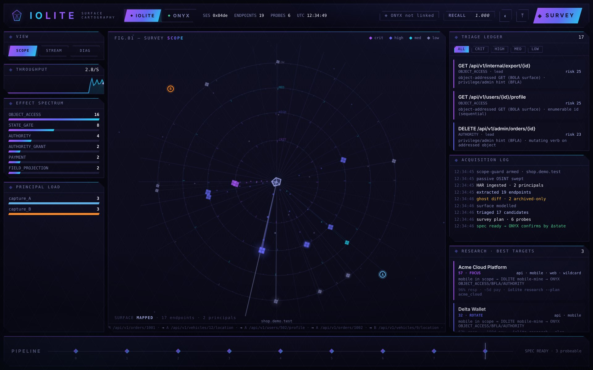

# IOLITE

[](https://github.com/NizarJasim1/iolite/actions/workflows/ci.yml)   

IOLITE maps the authorization attack surface of a web application from material you
are allowed to have: your own browsing captures, the JavaScript and sourcemaps the
site serves, GraphQL and OpenAPI documents, archived versions of the frontend, and
public OSINT. It models that surface, ranks every endpoint by authorization risk, and
writes a ready-to-run spec for [ONYX](https://github.com/NizarJasim1/Onyx).

IOLITE proposes what to test. It never decides whether something is a bug. That
call belongs to ONYX, which only reports a finding after a state read-back proves it.

```
captures, JS, schemas ──▶ IOLITE ──▶ spec.json ──▶ ONYX ──▶ confirmed findings
                         (map + rank)              (prove)
```

It is pure Python standard library and runs fully offline on captured inputs.


<sub>The control center after mapping the bundled demo target: effect spectrum,
radial risk map, triage ledger and acquisition log.</sub>

---

## Why it exists

ONYX is strict about proof, but it can only test endpoints it knows about. Most real
authorization bugs sit on routes nobody documented: an admin action still wired in
the JS bundle, an old API version the UI stopped calling, a mobile-only endpoint, a
GraphQL field the web client never asks for.

IOLITE is built to find that surface without crossing legal lines. Depth comes from
reading more sources carefully, not from hammering the target.

## Three ways it digs deeper

- **Time.** Diffing archived JavaScript against the current bundle surfaces *ghost
  endpoints*: gone from the UI, often still alive on the backend, and usually the
  first place authorization checks rot.
- **Client.** Web, mobile and partner clients often hit different backends with
  different checks. IOLITE captures all of them and lines them up.
- **Principal.** The same action captured as several accounts you own is the raw
  material for BOLA and BFLA tests between those accounts.

## Quick start

```bash
python -m iolite demo       # offline: mine the bundled fixtures, write spec + dossier
python -m iolite serve      # control center at http://127.0.0.1:8799
```

On your own captures:

```bash
python -m iolite roe-init                       # write an engagement / scope file

python -m iolite build --roe engagement.json \
    --har account_a.har --har account_b.har \
    --js main.js --sourcemap main.js.map \
    --archived-js main.2024.js \
    --graphql introspection.json --openapi openapi.json \
    --out spec.json --dossier surface.md

python -m authpath scan spec.json --out reports/  # hand it to ONYX
```

Or let it detect file types in a folder and verify the result with ONYX in one step:

```bash
export ONYX_PATH=/path/to/onyx
python -m iolite go --dir ./captures --scope api.example.test
```

## Commands

| command | what it does |
|---|---|
| `build` | full pipeline on your captured inputs → ONYX `spec.json` + human dossier |
| `go` | auto-detect a folder of captures, build, and verify with ONYX |
| `mine-js` | extract endpoints, params, roles and feature flags from JS and sourcemaps |
| `diff` | ghost-endpoint diff between current and archived JS |
| `triage` | show the authorization-risk ranking with the reason for each score |
| `reason` | reconstruct intended access rules from multi-account captures and turn gaps into ONYX candidates |
| `hunt` | per-account HARs → offline-confirmed issues plus ranked leads, no requests sent |
| `watch` | analyze traffic while you browse through a local collector |
| `verify` | check a spec through ONYX's own loaders, offline |
| `live` | fail-closed live gateway: preflight checks, then human-approved next steps |
| `research` | rank public bug-bounty programs by how well they fit this toolchain |
| `econ` | track time spent vs. outcomes per target: focus, rotate or drop |
| `selftest` | measure extraction recall and precision on a labeled bundle |
| `sim` | synthetic readiness run against modelled defences (WAF, rate limits, token expiry), no real traffic |
| `serve` | local control center |

## Rules it enforces

These are checked in code (`scope_guard.py`, `roe.py`), not just written down:

- **Scope first.** Every stage that could send a request goes through the scope guard.
  Anything outside the declared scope, or anything uncertain, results in no request.
- **Passive first.** Offline analysis and zero-touch OSINT run before anything touches
  the target. Live steps are opt-in and human-paced.
- **Own accounts only.** Cross-account probes are planned only between accounts you
  control. No real user's data is used as proof.
- **Provenance on every fact.** Each endpoint, parameter and role records where it came
  from and how strong that evidence is.
- **Deterministic.** No models, no learned baselines. Same inputs, byte-identical spec.
- **Proposes, never judges.** IOLITE cannot create a finding.

Things it refuses to do: brute force, high-volume fuzzing, bypassing authentication,
CAPTCHA, MFA or bot protection, and running automation where a program forbids it.
The full list is in [`docs/LEGAL_CEILING.md`](docs/LEGAL_CEILING.md).

## How it fits with the other tools

| tool | job |
|---|---|
| [Diamond Sword](https://github.com/NizarJasim1/diamond-sword) | drives an authorized browsing session and records it as multi-account HAR |
| **IOLITE** | turns those captures plus public sources into a ranked test spec |
| [ONYX](https://github.com/NizarJasim1/Onyx) | runs the spec and confirms findings by state read-back |

Each one works on its own. Together they go from "I have three test accounts" to
"here is a confirmed, reproducible authorization bug".

## Repository layout

```
iolite/            the engine
  intent/          intent reconstruction, live session, existence oracle, sim lab
  reason/          grey-box reasoning: invariants, coverage, write-ups
dashboard/         control center UI
fixtures/          labeled bundle, sample HARs, archived JS, GraphQL schema
tests/             test suite (tests/run_all.py)
docs/              architecture, pipeline, legal ceiling, live runbook, notes
```

## Development

```bash
make test        # full suite, stdlib only
make demo        # offline end-to-end run
ONYX_PATH=/path/to/onyx make test   # also runs the ONYX compatibility test
```

Design details: [`docs/ARCHITECTURE.md`](docs/ARCHITECTURE.md) and
[`docs/PIPELINE.md`](docs/PIPELINE.md). Release history: [`CHANGELOG.md`](CHANGELOG.md).

## Responsible use

Only use IOLITE on applications you own, intentionally vulnerable labs such as
[OWASP crAPI](https://github.com/OWASP/crAPI), or programs whose written scope allows
it. See [`SECURITY.md`](SECURITY.md).

## License

Source-available under the [PolyForm Noncommercial License 1.0.0](LICENSE). Free for
research, learning and other noncommercial use. Commercial use needs a separate
license; reach out through [GitHub](https://github.com/NizarJasim1).

---

Built and maintained by **Nizar Jasim Mohammed Al-Zubaidi** ([@NizarJasim1](https://github.com/NizarJasim1)).
